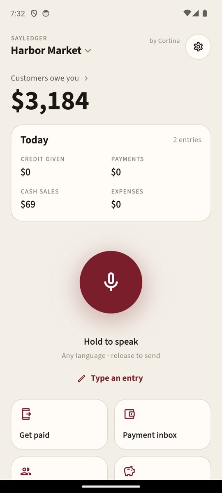
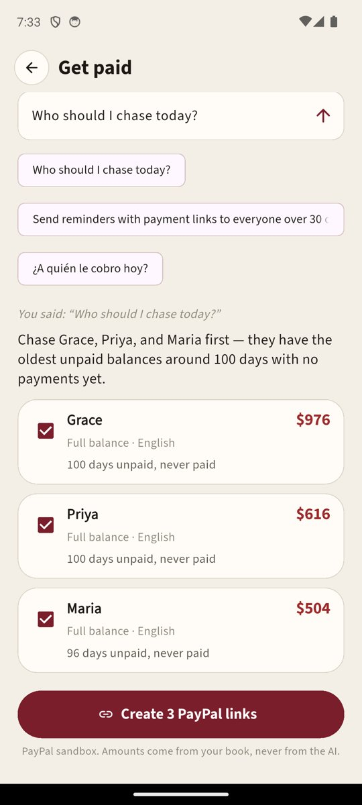
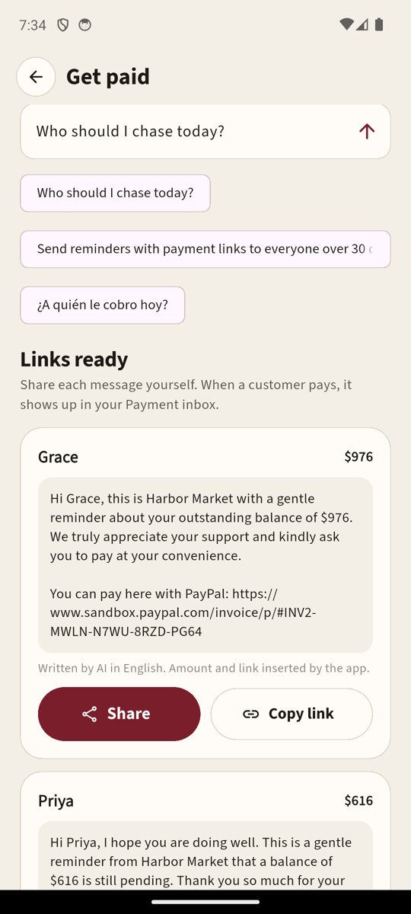
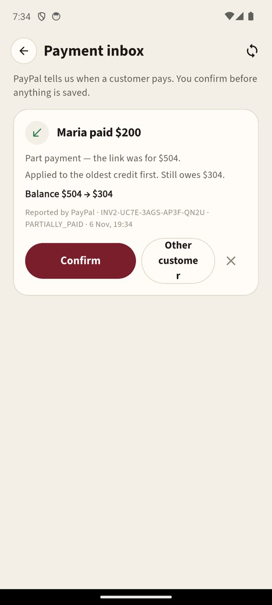
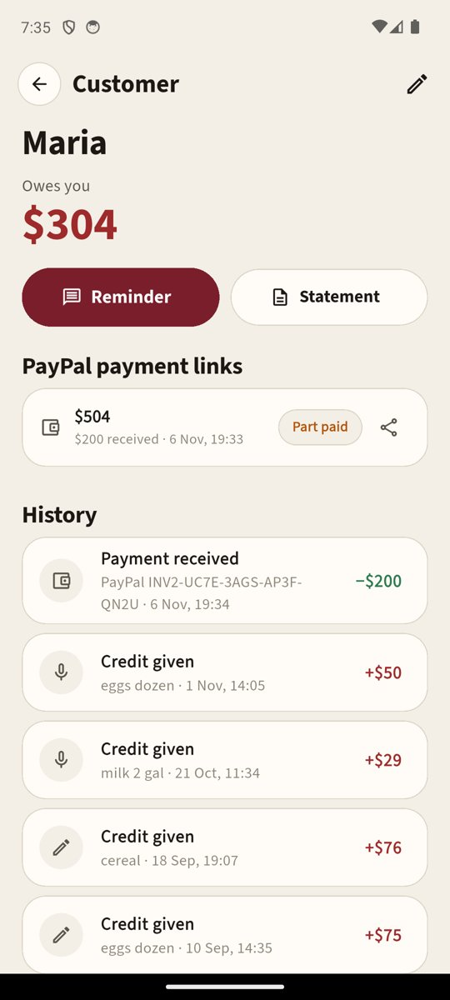

<p align="center"></p>

# SayLedger Collect by Cortina

-003087)

[](LICENSE)

**Say it. Send it. Get paid.**

Around 150,000 corner stores, bodegas, delis and food trucks in the US — and millions of small shops
worldwide — still run customer *tabs* in a paper notebook. Writing down the credit is only half the
job. The other half is getting paid: noticing who is overdue, asking politely, and then remembering
to cross it off when the money arrives somewhere else.

**SayLedger Collect closes that loop.** The shopkeeper asks *"Who should I chase today?"* (by voice,
in English or Spanish). An AI agent reads the credit book and proposes reminders. Each reminder
carries a **PayPal payment link for the exact amount owed**. When the customer pays — in full or
in part — PayPal tells our backend, and a **"Maria paid $200 — still owes $304"** card appears in the
shopkeeper's **Payment inbox**. One tap on **Confirm** and the book is up to date.

Built for the **PayPal AI Hackathon** (Nov 2026) on top of SayLedger, our voice credit book
(see [What is new for this hackathon](#what-is-new-for-this-hackathon)).

---

## Screenshots

| Home | Agent plan | Links ready | Payment inbox | Customer |
|---|---|---|---|---|
|  |  |  |  |  |

<sub>"Harbor Market" with invented customers and amounts. PayPal **sandbox** — no real money moves.</sub>

---

## The loop

```
 "Who should I chase today?"                                         customer opens the link
          │ voice / text                                             and pays (PayPal sandbox)
          ▼                                                                    │
 ┌─────────────────┐  read-only tools   ┌──────────┐                           ▼
 │ Collect agent   │ ─────────────────▶ │ ledger   │                ┌──────────────────────┐
 │ (Muse Spark)    │ ◀───────────────── │ (SQLite) │                │ PayPal Invoicing v2  │
 └────────┬────────┘   balances, ages   └──────────┘                └──────────┬───────────┘
          │ proposal cards (customer, amount FROM THE BOOK, language, why)     │ webhook
          ▼                                                                    │ INVOICING.INVOICE.PAID
 shopkeeper ticks cards ──▶ backend creates invoices ──▶ payer links           ▼
          │                  (paypal_client.py)          in AI-written    verify signature (PayPal
          ▼                                              messages         postback) → re-fetch invoice
 share sheet (WhatsApp / SMS) ──────────────────────────────────────▶    → inbox card (proposal only)
                                                                               │
                                              shopkeeper taps Confirm  ◀───────┘
                                              → payment entry, oldest credit cleared first
```

## How PayPal is used

All PayPal calls live in [`backend/app/paypal_client.py`](backend/app/paypal_client.py) (sandbox,
OAuth2 client credentials). Facts were checked against developer.paypal.com and the sandbox — see
[`docs/PAYPAL_NOTES.md`](docs/PAYPAL_NOTES.md).

| Step | PayPal API | Our rule |
|---|---|---|
| Payment link | `POST /v2/invoicing/invoices` → `POST …/{id}/send` (`send_to_recipient: false`) → **payer-view link** | Amount = the customer's balance from the ledger, or a smaller amount the shopkeeper typed. Never more than owed. Partial payments allowed (`configuration.partial_payment`) |
| Customer pays | PayPal hosted invoice page | The customer needs no app and we never see card data |
| Payment arrives | Webhook `INVOICING.INVOICE.PAID` / `REFUNDED` / `CANCELLED` → `POST /paypal/webhook` | Signature verified with `POST /v1/notifications/verify-webhook-signature` (raw body, never re-serialised). Unverified or duplicate events (same event id) never create inbox items |
| Amount | `GET /v2/invoicing/invoices/{id}` | We **re-fetch the invoice** and use PayPal's `paid_amount` — never amounts from the webhook body or from AI text |
| No webhook? | Same `GET`, from the **Check PayPal now** button (`POST /collect/sync`) | Fallback for local development and missed deliveries |
| One live link per customer | `POST …/{id}/cancel` | A new link cancels the customer's unpaid one (after a final re-check). PayPal refuses to cancel a part-paid invoice (422), so a part-paid link whose remainder matches is **reused** instead |
| Cash at the counter | `POST …/{id}/payments` (record payment) | Keeps the invoice in step when the customer pays in cash |

## Where the AI is

| Job | Model | The model does | Our code does |
|---|---|---|---|
| **Collect agent** — "Who should I chase today?", "Send Maria a payment link", "¿A quién le cobro hoy?" | `muse-spark-1.3` in a tool loop (max 6 steps) | Picks read-only tools (`list_owing`, `customer`, `find_customer`), ranks who to chase and says why | Runs the tools on the ledger, **validates every card**: customer must exist, must owe money, amount taken from the ledger (a smaller amount only if the shopkeeper asked), max 5 cards, language from a fixed list. Unknown customers are dropped and shown as "Skipped" |
| Voice command | `muse-voice-transcribe-1.0` | Speech → text | Same agent |
| Reminder text | `muse-spark-1.3` | A polite message in the customer's language with an `{AMOUNT}` placeholder | Inserts the exact amount and the PayPal link; falls back to a fixed template if the model adds a number |
| (base app) entries, ledger photos, questions, stock count | Muse Spark, Voice Transcribe, SAM 3.1 | see [Base app](#the-base-app-sayledger) | |

**The AI never moves money and never writes to the book.** It proposes; the shopkeeper ticks cards
before links are created, shares each message themselves, and confirms each payment.

## The Payment inbox

| PayPal reports | Card | Confirm does |
|---|---|---|
| Full payment | "Maria paid $504 — clears the balance" | Adds a *payment received* entry (source: PayPal) |
| Part payment | "Maria paid $200 — part payment, still owes $304" | Same; payments clear the oldest credit first, so ageing updates |
| More than owed | "… $20 more than owed — kept as advance" | Balance goes negative = advance |
| Refund | "PayPal refunded $15 to Maria" | Adds the money back to what she owes |
| Link cancelled | "Maria's payment link was cancelled" | Nothing — dismiss |
| Wrong person | **Change** → pick the customer | Saves against the chosen customer |

Every card shows what PayPal reported (invoice id, PayPal status, time) next to the proposal.

---

## Run it

### Backend (FastAPI)
```bash
cd backend
python3 -m venv .venv && .venv/bin/pip install -r requirements.txt
cp .env.example .env   # META_API_KEY, PAYPAL_CLIENT_ID, PAYPAL_CLIENT_SECRET (sandbox), PAYPAL_WEBHOOK_ID
.venv/bin/uvicorn app.main:app --port 8078
.venv/bin/python -m pytest -q   # 61 tests, no network (fake PayPal + fake model)
```
Sandbox keys: developer.paypal.com → Apps & Credentials → **Sandbox** → create an app. For webhooks the
backend needs a public HTTPS URL; add a webhook for `INVOICING.INVOICE.*` pointing at
`https://<your-host>/paypal/webhook` and put its id in `PAYPAL_WEBHOOK_ID`. Without a webhook,
use **Check PayPal now** in the Payment inbox.

**Hosting (cPanel / Passenger):** `backend/passenger_wsgi.py` runs the FastAPI app as a WSGI app
(`pip install a2wsgi`). Create a Python app in cPanel with the `backend` folder as its root, the
startup file `passenger_wsgi.py` and entry point `application`, and put the `.env` next to it. The
webhook URL is then `https://<your-domain>/sayledger-collect/paypal/webhook`.

Demo data: create a USD book in the app, then
`.venv/bin/python -m scripts.seed_demo data/books/<id>.db --currency USD` (invented customers).

### App (Flutter, Android)
```bash
cd app
adb reverse tcp:8078 tcp:8078
flutter run
```
On the first screen tap **Server** → `http://127.0.0.1:8078`, choose region **USA**. PayPal features
(Get paid, Payment inbox, link toggle) appear for USD / EUR / GBP / CAD / AUD books when the server has
PayPal keys. **The phone never holds a PayPal or Meta secret.**

To pay a link as a customer, open it in a browser and log in with a sandbox **Personal** account
(developer.paypal.com → Sandbox accounts).

---

## What we tested (honestly)

| | Status |
|---|---|
| Invoice create + send → payer link (USD, sandbox) | ✅ live sandbox |
| Agent "Who should I chase today?" → 3 cards with reasons → 3 real sandbox links + AI messages | ✅ live (emulator, Nov 6) |
| Part payment $200 of $504 → Check PayPal now → inbox card → Confirm → balance $304, ageing updated | ✅ live sandbox (payment recorded through the record-payment API) |
| New link for a part-paid customer reuses the open link and asks for the remainder | ✅ live sandbox |
| Spanish reminder message; agent commands in English and Spanish; off-topic refusal | ✅ live model |
| Webhook signature verification, duplicate events, unverified events ignored | ✅ unit tests; live delivery needs the public host |
| A real sandbox buyer paying through the PayPal page | ⏳ to be shown in the demo video |

## What is new for this hackathon

The PayPal submission period started Oct 1 2026. **SayLedger** (the voice credit book) was built
Oct 26 – Nov 4 2026 for the Meta AI hackathon. **Everything PayPal and agentic was added for this
hackathon (Nov 4 – Nov 12 2026)**, on branch `collect`:

- `backend/app/paypal_client.py` — Invoicing v2, webhook verification, cancel, record payment, QR
- `backend/app/collect.py` — payment requests, verified + idempotent webhook intake, re-fetch
  reconciliation, sync fallback, Payment inbox, confirm / change customer / dismiss, refunds, advances,
  one live link per customer
- `backend/app/collect_agent.py` — the Collect agent (tool loop, validated cards, link messages)
- `ledger` — new entry source `paypal`, schema v3
- App: **Get paid** screen, **Payment inbox**, **Add PayPal payment link** in reminders, link history
  per customer, **Who to chase today**, inbox banner, Settings → PayPal status
- 19 new tests

## The base app (SayLedger)

Hold-to-speak entries in any language with confirm cards · scan an old handwritten ledger page ·
ask your book questions · collections by age · reminders in 8 languages · customer statement PDF ·
reports (PDF / CSV) · day book · edit / cancel with an activity log · stock count from a shelf photo
(SAM 3.1) · backup / restore. Money is integer minor units; all maths in `ledger.py`; one private
SQLite book per install opened with a random token.

## What this is not

Not a payment processor, bank, lender, or accounting / tax software; no credit scores. PayPal does
the payments; SayLedger keeps the book. This build uses the **PayPal sandbox only**. PayPal links are
offered for USD, EUR, GBP, CAD and AUD books (PayPal India does not support domestic INR payments,
so INR books keep reminders without a link).

Code was written with AI coding assistance (Claude). All demo names and amounts are invented.

---

Made by **Lexcore Enterprises** · Cortina
